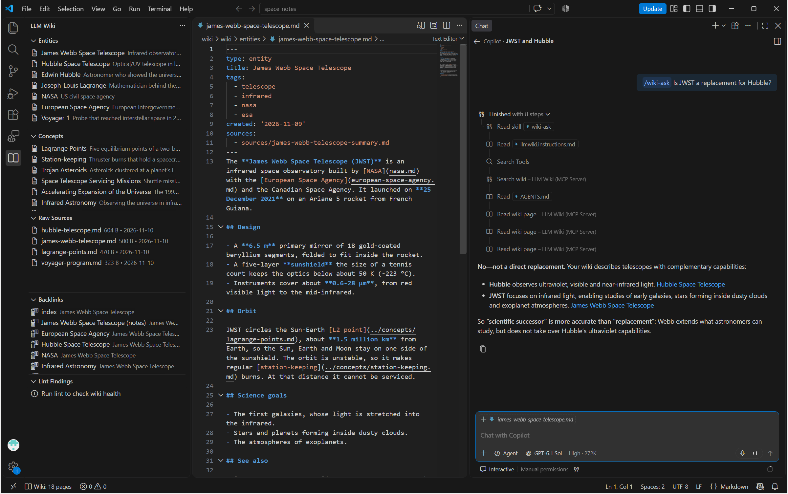

# LLM Wiki

> A personal knowledge base where the LLM does all the maintenance.

## What is this?

LLM Wiki is a VS Code extension for building personal knowledge bases that compound over time with zero bookkeeping burden. Instead of retrieving from raw documents at query time (like RAG), the LLM **incrementally builds and maintains a persistent wiki**: a structured, interlinked collection of markdown files that sits between you and your raw sources.

When you add a new source, the LLM reads it, extracts key information, and integrates it into the existing wiki — updating entity pages, revising topic summaries, noting contradictions, and strengthening the evolving synthesis. The knowledge is compiled once and kept current, not re-derived on every query.

You never write the wiki yourself. You curate sources, ask questions, and think. The LLM handles summarizing, cross-referencing, filing, and every other piece of maintenance that makes a knowledge base actually useful over time.

## Example interface



The LLM Wiki sidebar surfaces **Entities**, **Concepts**, **Raw Sources**, **Backlinks**, and **Lint Findings** tree views. The generated wiki pages open in the editor, and Copilot Chat answers questions that synthesize across multiple sources through the LLM Wiki MCP tools and skills.

## Architecture

The system has three layers:

| Layer | Owner | Purpose |
|-------|-------|---------|
| **Raw Sources** | Human | Immutable source documents — articles, papers, notes. The LLM reads but never modifies these. |
| **Wiki** | LLM | Generated markdown files — summaries, entity pages, concept pages, cross-references. The LLM owns this layer entirely. |
| **Schema** | Human + LLM | Conventions document (`AGENTS.md`) defining wiki structure, workflows, and rules. Co-evolved over time. |

See [ARCHITECTURE.md](./ARCHITECTURE.md) for full technical design and data-flow diagrams.

## Packages

The project is an npm workspaces monorepo with two packages:

| Package | npm name | Description |
|---------|----------|-------------|
| [packages/core](packages/core) | `@llmwiki/core` | Core wiki operations + MCP server — page I/O, index parsing, log management, lint checks and fixes, MCP tool server, ingest pipeline, bulk ingest, search, status. |
| [packages/vscode](packages/vscode) | `llmwiki` | VS Code extension — tree views, command palette, status bar, Copilot skills and the Wiki Librarian agent, bulk ingest of files and folders. |

The repository also contains an [agent plugin](plugin) (`plugin/`) that packages the same skills and agent with a self-contained MCP server for GitHub Copilot CLI, the GitHub Copilot app, and other Agent Plugins clients.

```
llmwiki (VS Code extension) ──depends-on──▶ @llmwiki/core
```

## Prerequisites

- [Node.js](https://nodejs.org/) v20 or later
- [VS Code](https://code.visualstudio.com/) 1.109 or later
- A GitHub Copilot subscription (the extension uses VS Code's Language Model API for ingestion enrichment)

## Installation

```bash
# Clone the repository
git clone <repo-url>
cd llmwiki

# Install all workspace dependencies
npm ci

# Build all packages (core → vscode)
npm run build

# Package the extension into a .vsix
npm run package --workspace=packages/vscode
```

After packaging, install the generated `packages/vscode/llmwiki-0.1.2.vsix` via **Extensions: Install from VSIX…** in the VS Code Command Palette.

## VS Code Extension

Open the **LLM Wiki** icon in the Activity Bar to access:

- **Entities** — Browse entity pages (people, products, places, organizations).
- **Concepts** — Browse concept pages (ideas, techniques, patterns).
- **Raw Sources** — See every file in `raw/` with size & date; right-click to remove.
- **Backlinks** — See pages that link to the page you currently have open.
- **Lint Findings** — Health-check results grouped by severity; click one to open the page.

### Commands

| Command | Title | Description |
|---------|-------|-------------|
| `llmwiki.init` | LLM Wiki: Initialize Wiki | Scaffold the `.wiki/` directory structure (raw, wiki, index, log, `AGENTS.md`). |
| `llmwiki.ingest` | LLM Wiki: Ingest Files or Folder | Bulk-ingest one or many files, or every supported file inside a folder (walked recursively). |
| `llmwiki.query` | LLM Wiki: Query Wiki | Weighted full-text search across index titles, summaries, and page bodies. |
| `llmwiki.status` | LLM Wiki: Show Status | Show page count, source count, coverage %, last ingest date. |
| `llmwiki.openPage` | LLM Wiki: Open Page | Quick-open any wiki page by title. |
| `llmwiki.search` | LLM Wiki: Search Wiki | Filter entities/concepts by title, summary, or tag. |
| `llmwiki.searchRaw` | LLM Wiki: Search Sources | Find a raw source file by name. |
| `llmwiki.refresh` | LLM Wiki: Refresh | Run lint-fix, prune orphaned pages, and refresh all views. |
| `llmwiki.lint` | LLM Wiki: Run Lint | Run health checks and show the results in the Lint Findings view. |
| `llmwiki.fix` | LLM Wiki: Fix Issues | Apply the deterministic fixes (stale index entries, unindexed pages, missing frontmatter, pages whose sources were removed) and list what still needs judgment in Lint Findings. |
| `llmwiki.fixWithCopilot` | LLM Wiki: Fix Remaining Issues with Copilot | Open Copilot Chat with the `/wiki-fix` skill to resolve the remaining findings. |
| `llmwiki.removeSource` | LLM Wiki: Remove Source | Delete a raw source, its summary page, and the wiki pages derived only from it (pages that also draw on another source are kept). |
| `llmwiki.scanRaw` | LLM Wiki: Scan Sources for New Files | Scan `raw/` for files that have no wiki page yet and offer to ingest them. |
| `llmwiki.selectModel` | LLM Wiki: Select Model | Choose which installed GitHub Copilot model family powers LLM-powered ingestion. |

### Bulk Ingest

The **LLM Wiki: Ingest Files or Folder** command supports four invocation modes:

1. **Command Palette** — first choose **Files** or **Folder** mode, then select one or more items in the native picker. (The modes are split because a single OS dialog can't reliably select both files and folders at once.)
2. **Explorer context menu** — right-click any file or folder anywhere in the Explorer and choose **LLM Wiki: Ingest Files or Folder**. Multi-selections (Ctrl/Shift-click) are honoured.
3. **Raw Sources toolbar** — click the **+** (Ingest Files or Folder) button in the Raw Sources view title bar.
4. **Drag-and-drop into `raw/`** — files dropped into the Raw Sources view are auto-ingested by the file watcher.

When a folder is selected the extension walks it recursively, skipping `.`-prefixed entries and common build directories (`node_modules`, `dist`, `out`, `build`, `.wiki`). External files are copied into `<workspace>/.wiki/raw/` first, then sent through the per-file ingestion pipeline. Selecting more than 20 files triggers a confirmation prompt so you don't kick off a huge batch by accident.

### Copilot Chat: skills and the Wiki Librarian agent

The extension contributes Copilot customizations that work in the Copilot harness (which VS Code 1.142 began rolling out as the default for new chat sessions) as well as the Local harness. They are available in workspaces that contain a wiki.

- **Just ask.** In Agent mode, questions about your wiki are answered through the LLM Wiki MCP tools, which the extension registers automatically. Read-only tools are annotated as such, so they run without confirmation prompts.
- **Skills** (type `/` in chat):

  | Skill | Use it to |
  |-------|-----------|
  | `/wiki-ask` | Answer a question from the wiki and cite the pages used. Copilot also loads it automatically for wiki questions. |
  | `/wiki-research` | Synthesize everything the wiki knows about a topic and list knowledge gaps. Also loaded automatically. |
  | `/wiki-ingest` | Ingest a source and integrate it: summary, entities, concepts, crosslinks, health check. Also loaded automatically. |
  | `/wiki-save` | Save the previous answer as a page under `wiki/queries/`. Runs only when you invoke it. |
  | `/wiki-fix` | Apply the deterministic fixes, then resolve broken links and other findings that need judgment, asking before deleting anything. Runs only when you invoke it. |

- **Wiki Librarian** — a custom agent in the agent picker for longer sessions with the wiki.
- **Instructions** — guidance applied whenever chat works with files under `.wiki/`.

#### Migrating from `@wiki`

VS Code [deprecated chat participants](https://code.visualstudio.com/api/extension-guides/ai/chat), and they don't run in the Copilot harness, so the `@wiki` participant has been removed.

| Before | Now |
|--------|-----|
| `@wiki <question>` | Ask in Agent mode, or use `/wiki-ask <question>` |
| `@wiki /status` | The status bar item, **LLM Wiki: Show Status**, or the `wiki_status` tool |
| `@wiki /lint` | **LLM Wiki: Run Lint** (results in the Lint Findings view) or the `wiki_lint` tool |
| `@wiki /fix` | **LLM Wiki: Fix Issues** for the deterministic fixes, then `/wiki-fix` (or **Fix with Copilot**) for the rest |
| `@wiki /save` | `/wiki-save [title]` (previously only suggested a path) |

### Settings

| Setting | Default | Description |
|---------|---------|-------------|
| `llmwiki.modelFamily` | `claude-opus-4.6` | Preferred GitHub Copilot model family for LLM-powered ingestion. Falls back to any available Copilot model when the requested family isn't installed; leave blank to always use the first available model. Run **LLM Wiki: Select Model** to pick one interactively. |

## MCP Server

The `@llmwiki/core` package also exposes a Model Context Protocol server so external agents (Claude Desktop, Cursor, VS Code Copilot via MCP, Copilot CLI, etc.) can read, write, and maintain wiki content programmatically.

Every tool declares a title and [annotations](https://modelcontextprotocol.io/specification/2025-11-25/server/tools#tool-annotations): read-only tools are marked `readOnlyHint`, so VS Code runs them without a confirmation prompt, and tools that overwrite or delete content are marked `destructiveHint`. The server also sends **instructions** that explain how to use the wiki, followed by the wiki's own `AGENTS.md` schema.

### Connecting from VS Code (automatic)

If you have the LLM Wiki VS Code extension installed, the MCP server registers itself automatically through VS Code's `mcpServerDefinitionProviders` contribution. No JSON to edit — just initialize a wiki (`LLM Wiki: Initialize Wiki`) and the `LLM Wiki` server will appear in the Copilot MCP server list. The launcher is started on demand using the editor's bundled Node.

### Copilot CLI, the GitHub Copilot app, and other agent plugin clients

The [agent plugin](plugin) bundles the skills, the Wiki Librarian agent, and a self-contained MCP server (it needs Node.js 20+ on `PATH`):

```bash
copilot plugin install microsoft/llmwiki:plugin
# or, through the marketplace index in this repository:
copilot plugin marketplace add microsoft/llmwiki
copilot plugin install llmwiki@llmwiki
```

Plugin skills are prefixed with the plugin name, for example `/llmwiki:wiki-ask`. In VS Code, install the extension rather than the plugin; it contributes the same skills and agent.

### How the server finds the wiki

`llmwiki-mcp [wiki-root]` uses the wiki root (the `.wiki` directory) given as its argument or in the `LLMWIKI_ROOT` environment variable, and works only on that wiki. Without either, it uses `<cwd>/.wiki` if that exists when it starts; otherwise it looks in the client's workspace roots on the first tool call. In that mode it also offers two more tools: `wiki_open` selects a wiki by path, and `wiki_init` creates one. This is how the plugin works, because plugin servers start in the plugin folder.

### Connecting from Claude Desktop / Cursor / other MCP clients

The shared package ships an `llmwiki-mcp` stdio launcher. Add it to your client's MCP configuration:

```jsonc
// Claude Desktop: claude_desktop_config.json
// Cursor:        ~/.cursor/mcp.json
{
  "mcpServers": {
    "llmwiki": {
      "command": "npx",
      "args": ["-y", "-p", "@llmwiki/core", "llmwiki-mcp", "/absolute/path/to/your-project/.wiki"]
    }
  }
}
```

If you've installed `@llmwiki/core` globally (`npm i -g @llmwiki/core`), you can use `llmwiki-mcp` directly as the command instead of going through `npx`. Without npm, point the client at the self-contained bundle in a clone of this repository: `"command": "node", "args": ["/path/to/llmwiki/plugin/server/llmwiki-mcp.cjs", "/absolute/path/to/your-project/.wiki"]`.

### Manual JSON config

To pin the server in a workspace for the Copilot harness and Copilot CLI, add a `.mcp.json` at the workspace root:

```jsonc
{
  "mcpServers": {
    "llmwiki": {
      "command": "npx",
      "args": ["-y", "-p", "@llmwiki/core", "llmwiki-mcp", ".wiki"]
    }
  }
}
```

For the Local harness in VS Code, use `.vscode/mcp.json`:

```jsonc
{
  "servers": {
    "llmwiki": {
      "command": "npx",
      "args": ["-y", "-p", "@llmwiki/core", "llmwiki-mcp", "${workspaceFolder}/.wiki"]
    }
  }
}
```

### Available Tools

**Read tools** (read-only):

| Tool | Description |
|------|-------------|
| `wiki_status` | Wiki statistics — source count, page count, coverage, lint dates |
| `wiki_query` | Free-text search with weighted relevance scoring |
| `wiki_lint` | Health checks grouped by severity, with category filter |
| `wiki_list_pages` | All wiki pages with frontmatter metadata |
| `wiki_list_sources` | All raw source files with size and date |
| `wiki_read_page` | Read a single page by path (frontmatter + body) |
| `wiki_read_index` | All index entries with title, summary, category, tags |

**Write tools:**

| Tool | Description |
|------|-------------|
| `wiki_write_page` | Create or overwrite a page (auto-updates index) |
| `wiki_create_entity` | Create entity page at `entities/{slug}.md`, optionally recording its `sources` |
| `wiki_create_concept` | Create concept page at `concepts/{slug}.md`, optionally recording its `sources` |
| `wiki_update_page` | Merge partial updates into an existing page; `addSources` extends a derived page's sources |
| `wiki_add_crosslinks` | Add "See also" links (validates targets exist) |
| `wiki_update_index` | Update index entry metadata |
| `wiki_ingest_with_context` | Ingest a source (path relative to the wiki root, e.g. `raw/article.md`) with a context-rich response |
| `wiki_fix` | Apply the deterministic fixes; `dryRun` previews them |
| `wiki_delete_page` | Delete a page and its index entry; reports pages that still link to it |

**Workspace tools** (only when the server isn't bound to a wiki root): `wiki_open` and `wiki_init`.

`wiki_status`, `wiki_query`, `wiki_lint` and `wiki_fix` also return structured results that match their declared output schemas.

**Prompts & resources:** Beyond tools, the server also registers MCP **prompts** (`ingest-and-integrate`, `lint-and-fix`, `research-topic`) and **resources** — `resource://wiki/index`, `resource://wiki/pages`, `resource://wiki/sources`, plus the `resource://wiki/pages/{path}` and `resource://wiki/sources/{path}` templates — so agents can browse wiki content without invoking tools. Argument completions suggest page paths, source paths and topics.

See [docs/mcp-tools.md](docs/mcp-tools.md) for the full tool reference with schemas and workflows.

## GitHub Actions

[.github/workflows/ci.yml](.github/workflows/ci.yml) runs on push and PR to `main`. It installs dependencies, builds `@llmwiki/core` and the VS Code extension, checks that the committed plugin server bundle is up to date, type-checks both packages, runs the full test suite with coverage, and writes a coverage summary to the run.

## Development

```bash
npm ci            # Install all workspace dependencies
npm run build     # Build all packages (core → vscode) and plugin/server/llmwiki-mcp.cjs
npm test          # Run tests (vitest)
npm run lint      # Type-check all packages (tsc --noEmit)
npm run dev       # Watch mode (vitest watch)
npm run coverage  # Run tests with coverage reporting (@vitest/coverage-v8)
npm run test:integration  # Run the extension in a real VS Code instance (after npm run build)
```

`npm run build` regenerates `plugin/server/llmwiki-mcp.cjs`; commit it together with any change to `@llmwiki/core`. The skills, agent and instructions are authored once in `plugin/` and copied into the extension at build time.

**Per-package commands:**

```bash
npm run build --workspace=packages/core    # Build core library
npm run build --workspace=packages/vscode    # Build VS Code extension
npm run watch --workspace=packages/vscode    # Rebuild extension on change
npm run package --workspace=packages/vscode  # Produce a .vsix
```

## License

[MIT](LICENSE) — Copyright (c) Microsoft Corporation.
